# Hybrid Analysis Process Diagram

The tool combines syntactic analysis, static taint analysis, and guided dynamic execution. Static results configure the fuzzer; they are not merely reported alongside it.

```mermaid
flowchart LR
    BC[Java bytecode]

    subgraph STATIC[Static phase]
        CG[Call graph analysis]
        DICT[String dictionary analysis]
        TA[Interprocedural taint analysis]
        FIND[Taint findings]
        GUIDE[Fuzzing guidance]
    end

    subgraph DYNAMIC[Dynamic phase]
        FZ[Coverage-guided fuzzer]
        RUN[Execute candidate input]
        COV[Coverage feedback]
        ORACLE[Exploit oracle: canary reached]
    end

    subgraph OUTPUT[Output]
        CLASS[Classify result]
        TEST[Generate reproducible Java test]
    end

    BC -->|method calls| CG
    BC -->|string constants and comparisons| DICT
    BC -->|JVM instructions| TA
    CG -->|interprocedural edges| TA

    TA -->|sink PC and source labels| FIND
    CG -->|targets and distance to sink| GUIDE
    FIND -->|relevant parameters and sinks| GUIDE

    DICT -->|candidate values| FZ
    GUIDE -->|mutation priorities and fitness targets| FZ
    FZ -->|candidate input| RUN
    RUN -->|covered instructions and methods| COV
    COV -->|retain and mutate interesting inputs| FZ

    RUN -->|dynamic behavior| ORACLE
    FIND -->|static warning| CLASS
    ORACLE -->|confirmed or not confirmed| CLASS
    FZ -->|discovered input| TEST
    CLASS -->|confirmed vulnerability| TEST
```



## Information exchanged between components

- **Call graph analysis** identifies possible method calls. It enables interprocedural taint propagation and provides a method-level distance to configured sinks.
- **Dictionary analysis** extracts string constants and comparison values from the bytecode. These values seed and mutate fuzzer inputs.
- **Taint analysis** reports which entry-method parameter labels may reach sensitive sink arguments or receivers. It is a flow-sensitive, path-insensitive may-analysis computed to a fixpoint.
- **Fuzzing guidance** combines call-graph and taint results. It tells the fuzzer which parameters to prioritize and which methods or sinks should improve fitness when reached.
- **Coverage feedback** retains inputs that discover new instructions or methods and uses them as the basis for further mutations.
- **Test synthesis** converts a dynamically confirmed input into a reproducible Java test rather than emitting only a raw function call or input value.

## Sink and oracle distinction

A **security sink** is a sensitive operation such as reflective class selection or simulated deserialization. A tainted value reaching a configured sink produces a static `TaintFinding`.

The **exploit oracle** is the benchmark canary. Reaching it during concrete execution confirms that the simulated exploit succeeded. A static finding without a reached oracle remains unverified; it is not automatically a false positive.

The combined classification is:

```text
no static finding                     -> unflagged within the model
static finding, oracle not reached    -> flagged but unverified
static finding, oracle reached        -> dynamically confirmed vulnerability
```

## Initial scope

The first implementation tracks explicit data flows, uses context-insensitive interprocedural analysis, models heap references by allocation site, and relies on trusted summaries for unsupported library behavior. Implicit-flow tracking, path sensitivity, and deeper context sensitivity are deferred extensions.
